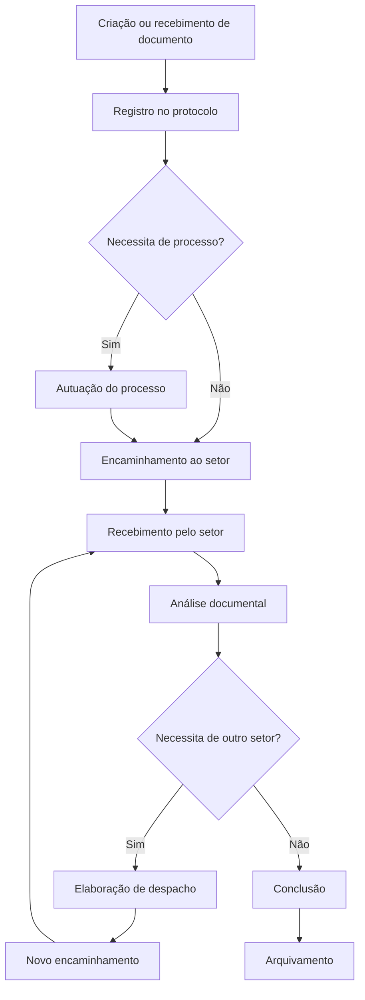

# Docly

**Sistema de Gestão Eletrônica de Documentos e Processos Administrativos**

O Docly é uma aplicação web self-hosted desenvolvida para centralizar e gerenciar documentos e processos administrativos dentro de uma organização.

A plataforma tem como objetivo facilitar o registro, organização, encaminhamento e acompanhamento de documentos entre diferentes setores, proporcionando rastreabilidade, controle de acesso e histórico das movimentações.

O projeto é inspirado em sistemas de gestão documental e tramitação administrativa, buscando oferecer uma interface moderna, intuitiva e uma arquitetura modular.

## 🎯 Objetivos

- Centralizar a gestão de documentos institucionais.
- Permitir o registro e controle de protocolos.
- Organizar documentos em processos administrativos.
- Gerenciar a tramitação de processos entre setores.
- Registrar despachos e manifestações administrativas.
- Manter o histórico completo das movimentações.
- Controlar usuários, setores e permissões.
- Facilitar a consulta e recuperação de documentos.

## ✨ Funcionalidades planejadas

### 📁 Gestão de documentos
- Cadastro e registro de documentos.
- Upload e armazenamento de arquivos.
- Classificação e categorização documental.
- Organização de documentos por processos.
- Controle de versões.

### 📋 Gestão de protocolos
- Registro de documentos recebidos e produzidos.
- Numeração automática de protocolos.
- Identificação de interessados.
- Controle de datas e responsáveis.
- Pesquisa e consulta de protocolos.

### 🔄 Gestão de processos
- Autuação de processos administrativos.
- Vinculação de documentos.
- Acompanhamento da situação processual.
- Histórico de movimentações.
- Encerramento e arquivamento.

### 🏢 Tramitação entre setores
- Encaminhamento de processos.
- Recebimento de processos.
- Transferência de responsabilidade.
- Elaboração de despachos.
- Devolução e solicitação de complementação.

### 👥 Gestão administrativa
- Cadastro de usuários.
- Cadastro de organizações e setores.
- Associação de usuários aos setores.
- Controle de permissões e níveis de acesso.

### 📊 Dashboard e relatórios
- Processos recebidos e enviados.
- Processos pendentes.
- Documentos registrados.
- Indicadores de movimentação.
- Acompanhamento de atividades por setor.

## 🛠️ Tecnologias

| Tecnologia | Finalidade |
|---|---|
| Python | Linguagem principal |
| Flask | Framework backend |
| Flask-SQLAlchemy | ORM e integração com banco |
| MariaDB | Banco de dados relacional |
| PyMySQL | Driver de conexão |
| Flask-Migrate | Gerenciamento de migrations |
| Flask-Login | Autenticação e sessões |
| Flask-WTF | Formulários e validação |
| Jinja2 | Renderização de templates |
| HTMX | Interações dinâmicas |
| Tailwind CSS | Estilização da interface |
| Docker | Containerização |

## 🏗️ Arquitetura

O Docly será desenvolvido utilizando uma arquitetura de monólito modular, separando as responsabilidades da aplicação em módulos independentes.

Estrutura inicial planejada:

```text
docly/
├── app/
│   ├── __init__.py
│   ├── config.py
│   ├── extensions.py
│   │
│   ├── models/
│   │
│   ├── modules/
│   │   ├── auth/
│   │   ├── dashboard/
│   │   ├── protocol/
│   │   ├── documents/
│   │   ├── processes/
│   │   ├── movements/
│   │   ├── departments/
│   │   └── archive/
│   │
│   ├── templates/
│   └── static/
│
├── migrations/
├── tests/
├── docker-compose.yml
├── Dockerfile
├── requirements.txt
└── run.py
```

## 🔄 Fluxo de funcionamento

O fluxo administrativo principal previsto para o Docly será:



## 🚀 Desenvolvimento

O projeto está em fase inicial de desenvolvimento.

As funcionalidades serão implementadas progressivamente, priorizando uma base arquitetural organizada, segurança, integridade dos dados e facilidade de manutenção.

### Etapas planejadas

- [ ] Estrutura inicial da aplicação Flask.
- [ ] Configuração do MariaDB e SQLAlchemy.
- [ ] Configuração do Docker Compose.
- [ ] Sistema de autenticação.
- [ ] Gestão de usuários.
- [ ] Gestão de organizações e setores.
- [ ] Dashboard.
- [ ] Gestão documental.
- [ ] Sistema de protocolo.
- [ ] Gestão de processos.
- [ ] Tramitação entre setores.
- [ ] Despachos administrativos.
- [ ] Auditoria e histórico.
- [ ] Arquivamento e relatórios.

## 🐳 Execução

A aplicação será disponibilizada por meio de containers Docker, facilitando sua instalação, configuração e manutenção em ambientes self-hosted.

As instruções completas de instalação e configuração serão adicionadas conforme a implementação da infraestrutura.

## 🔐 Segurança

O projeto prevê a implementação de:

- Autenticação e controle de sessões.
- Controle de acesso baseado em permissões.
- Proteção de documentos e arquivos.
- Registro de ações dos usuários.
- Integridade e rastreabilidade das movimentações.
- Configurações sensíveis por variáveis de ambiente.

## 📌 Status

**Em desenvolvimento — versão inicial.**

## 📄 Licença

Este projeto está licenciado sob a [MIT License](LICENSE).

Copyright (c) 2026 Yuri Simioni

É permitido utilizar, copiar, modificar, distribuir e sublicenciar o software, desde que o aviso de copyright e o texto da licença sejam preservados.